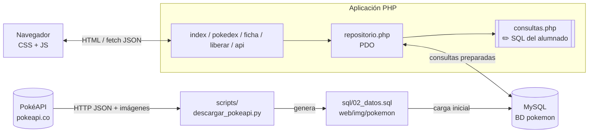
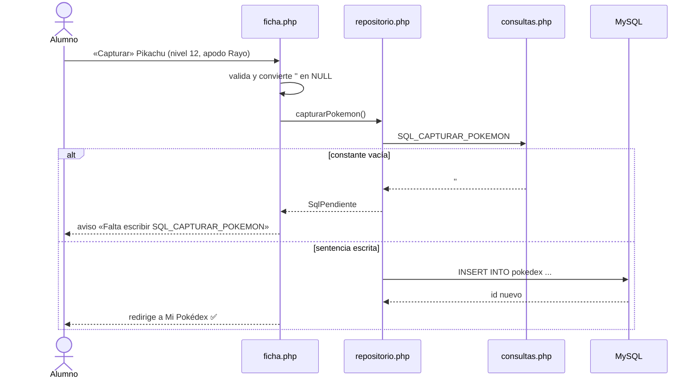
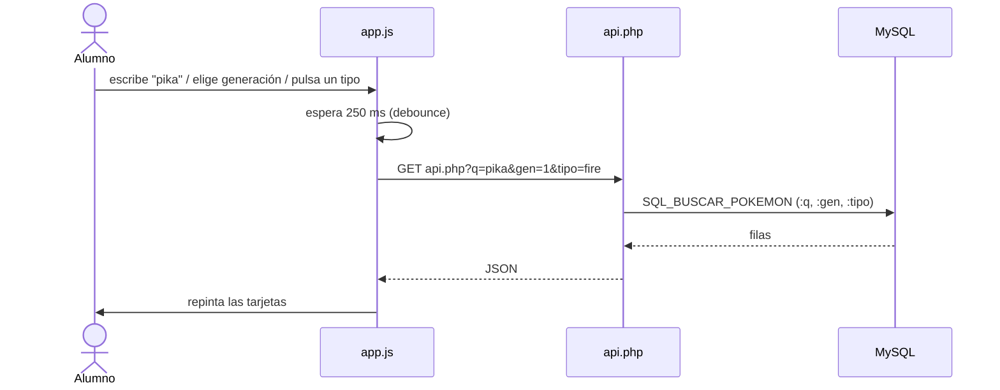
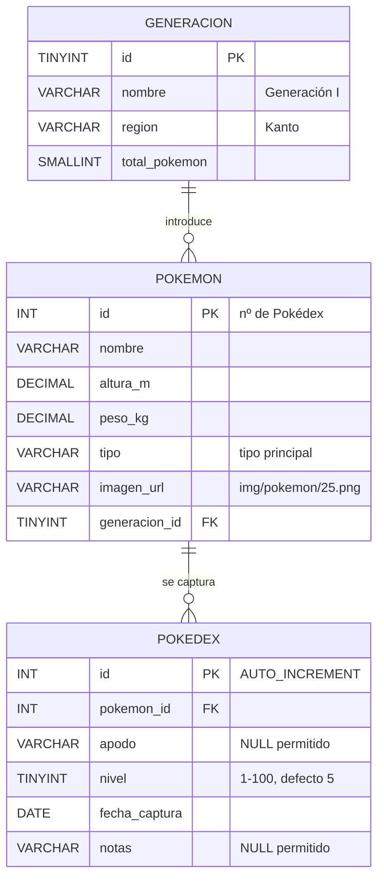
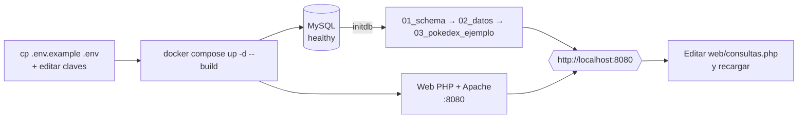
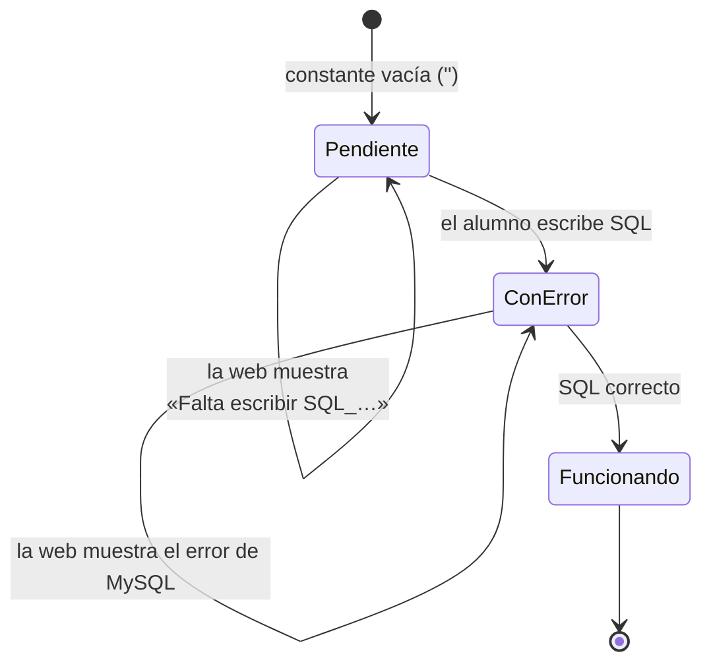
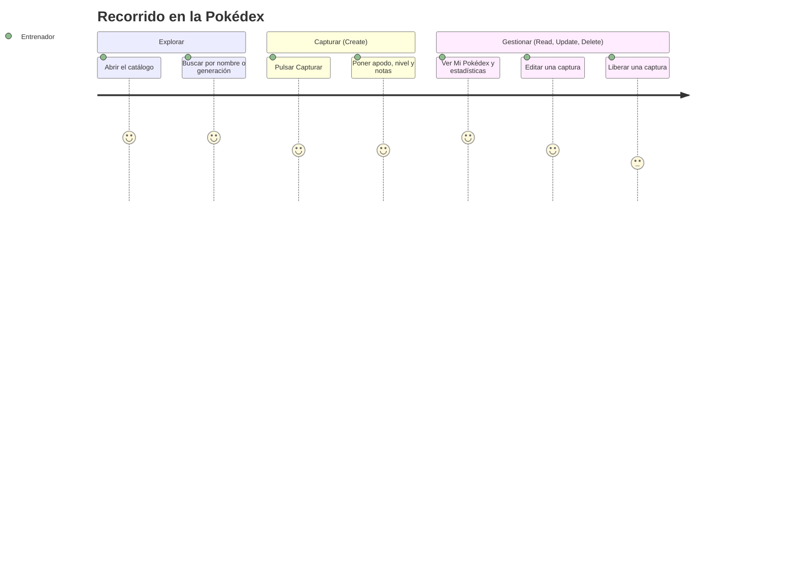
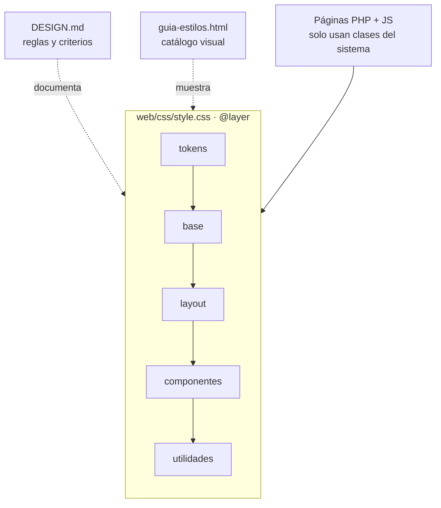
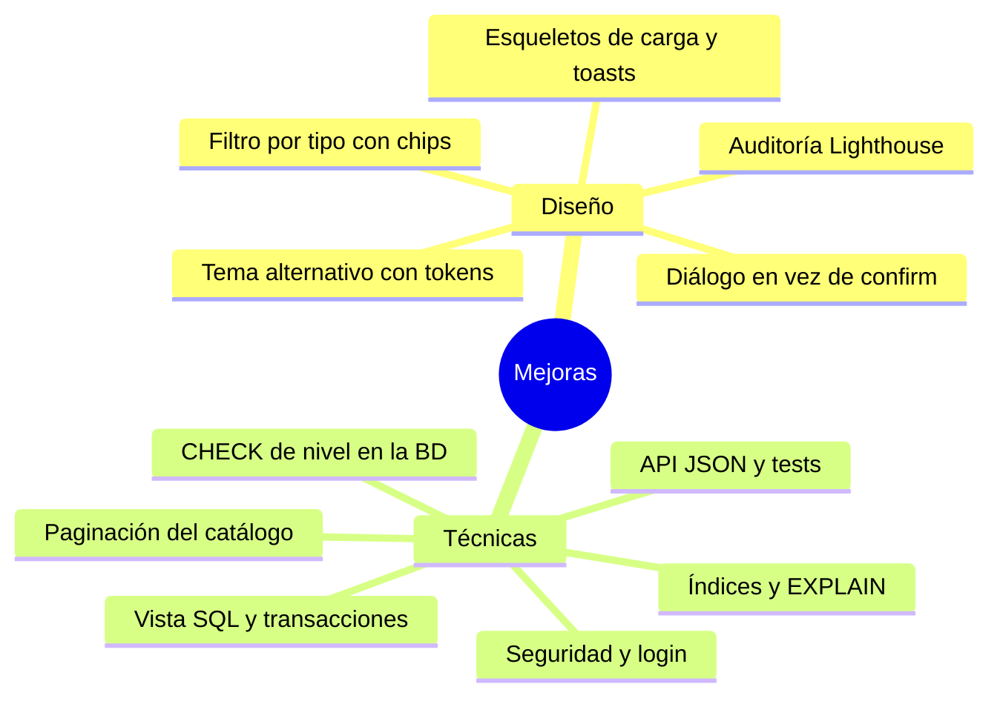

# Pokémon · CRUD de una Pokédex en PHP con SQL escrito por el alumnado

Actividad de clase (DAW) para practicar **SQL (SELECT, JOIN, INSERT, UPDATE, DELETE, GROUP BY)**
dentro de una aplicación web real en **PHP + PDO + MySQL**. El catálogo de Pokémon son datos reales de
[PokéAPI](https://pokeapi.co/) y **no se toca**: el CRUD se hace sobre una tabla nueva, **`pokedex`**
(los Pokémon que captura el entrenador). La aplicación ya está construida: **el alumnado solo escribe
las sentencias SQL** en un único fichero, [`web/consultas.php`](web/consultas.php), y ve cómo la web va
cobrando vida.

| Documento | Para qué sirve |
|---|---|
| **[EJERCICIO.md](EJERCICIO.md)** | Paso a paso para desplegar y resolver la actividad, entrega, y **mejoras a incorporar** |
| **[DESIGN.md](DESIGN.md)** | Sistema de diseño: tokens, componentes, accesibilidad |
| [web/guia-estilos.html](web/guia-estilos.html) | Guía visual viva (`http://localhost:8080/guia-estilos.html`) |

## Índice

1. [Qué contiene el proyecto](#1-qué-contiene-el-proyecto)
2. [Arquitectura](#2-arquitectura)
3. [Modelo de datos](#3-modelo-de-datos)
4. [Requisitos y puesta en marcha](#4-requisitos-y-puesta-en-marcha)
5. [La actividad: escribe las sentencias SQL](#5-la-actividad-escribe-las-sentencias-sql)
6. [Cómo funciona la web](#6-cómo-funciona-la-web)
7. [Sistema de diseño](#7-sistema-de-diseño)
8. [Regenerar los datos desde PokéAPI](#8-regenerar-los-datos-desde-pokéapi)
9. [Notas para el profesorado](#9-notas-para-el-profesorado)
10. [Mejoras y ampliaciones](#10-mejoras-y-ampliaciones)
11. [Problemas frecuentes](#11-problemas-frecuentes)

## 1. Qué contiene el proyecto

```text
pokemon/
├── README.md                 # este documento
├── EJERCICIO.md              # paso a paso de la actividad + mejoras
├── DESIGN.md                 # sistema de diseño
├── docker-compose.yml        # MySQL + web PHP con un solo comando
├── .env.example              # plantilla de configuración (copiar a .env)
├── sql/
│   ├── 01_schema.sql         # crea la BD y las 3 tablas
│   ├── 02_datos.sql          # catálogo de PokéAPI (generado por el script)
│   └── 03_pokedex_ejemplo.sql# 4 capturas de ejemplo
├── scripts/
│   └── descargar_pokeapi.py  # PokéAPI -> sql/02_datos.sql (+ imágenes)
└── web/
    ├── consultas.php         # ✏️ LO ÚNICO QUE EDITA EL ALUMNADO (sentencias SQL)
    ├── repositorio.php       # ejecuta las sentencias con PDO (no tocar)
    ├── config.php            # conexión PDO (no tocar)
    ├── index.php             # Catálogo: buscador, filtro por generación y tipo, botón «Capturar»
    ├── pokedex.php           # Mi Pokédex: listado de capturas y estadísticas
    ├── ficha.php             # capturar / editar una captura
    ├── liberar.php           # borrar una captura
    ├── api.php               # JSON para la búsqueda en vivo del catálogo
    ├── guia-estilos.html     # catálogo visual del sistema de diseño
    ├── css/style.css         # sistema de diseño (tokens + componentes, en @layer)
    ├── js/app.js             # búsqueda en vivo
    ├── js/tema.js            # tema claro/oscuro
    ├── img/pokemon/          # 1025 imágenes en local ({id}.png)
    ├── img/favicon.svg
    └── Dockerfile
```

## 2. Arquitectura



Flujo de una captura (Create) y qué pasa si falta la sentencia:



Búsqueda en vivo del catálogo:



## 3. Modelo de datos



- `generacion` y `pokemon` son el **catálogo (solo lectura)**; el CRUD se hace en **`pokedex`**.
- Se puede capturar el mismo Pokémon varias veces (cada captura tiene su `id`, apodo y nivel).
- No se puede capturar un `pokemon_id` inexistente ni borrar del catálogo un Pokémon capturado (claves foráneas con `RESTRICT`).
- Las imágenes están en local (`web/img/pokemon/{id}.png`) y `imagen_url` guarda rutas como `img/pokemon/25.png`: **la actividad funciona sin internet**.

## 4. Requisitos y puesta en marcha

Necesitas **Docker + Docker Compose** (y un editor de texto). Python 3 solo si quieres regenerar los datos.

```bash
cp .env.example .env        # elige tus claves; .env no se sube a git
nano .env
docker compose up -d --build
# Web:  http://localhost:8080
```



- La primera vez, MySQL ejecuta `sql/*.sql` automáticamente (esquema, catálogo y capturas de ejemplo).
- `web/` está montada en el contenedor: **guardas `consultas.php` y recargas el navegador**.
- Reiniciar los datos desde cero: `docker compose down -v && docker compose up -d`.
- Probar SQL a mano: `docker compose exec db mysql -u pokemon -p pokemon`.

Sin Docker: MySQL/MariaDB y PHP ≥ 8.1 con `pdo_mysql` (p. ej. XAMPP). Importa los tres `.sql` en orden,
crea un usuario con permisos sobre `pokemon` y define las variables `DB_*` del `.env.example` en el servidor web.

## 5. La actividad: escribe las sentencias SQL

> El **paso a paso completo** (despliegue, pistas, comprobaciones, entrega y mejoras) está en **[EJERCICIO.md](EJERCICIO.md)**.

El progreso de la actividad se ve en la web: cada sentencia pasa de «pendiente» a «funcionando».



Recorrido del usuario por la aplicación:



Abre [`web/consultas.php`](web/consultas.php). Hay **3 ejemplos ya resueltos** sobre el catálogo (léelos:
muestran JOIN, `LIKE` y filtros opcionales) y **6 sentencias vacías** sobre `pokedex`. La web te dice cuál
falta (aviso rojo) y, si tu SQL tiene un error, muestra el mensaje de MySQL.

| # | Constante | Operación | Conceptos | Dónde se ve el resultado |
|---|---|---|---|---|
| – | `SQL_LISTAR_GENERACIONES`, `SQL_BUSCAR_POKEMON`, `SQL_OBTENER_POKEMON` | SELECT | *ejemplos resueltos* | Catálogo |
| 1 | `SQL_LISTAR_POKEDEX` | **Read** | JOIN de 3 tablas, alias, ORDER BY con dos criterios | página **Mi Pokédex** |
| 2 | `SQL_CAPTURAR_POKEMON` | **Create** | INSERT, AUTO_INCREMENT, NULL, clave foránea | botón **Capturar** del catálogo |
| 3 | `SQL_OBTENER_POKEDEX` | **Read** (una fila) | WHERE por clave primaria + JOIN | botón **Editar** (rellena el formulario) |
| 4 | `SQL_ACTUALIZAR_POKEDEX` | **Update** | UPDATE … SET … WHERE | **Editar → Guardar** |
| 5 | `SQL_LIBERAR_POKEMON` | **Delete** | DELETE … WHERE | botón **Liberar** |
| 6 | `SQL_RESUMEN_POKEDEX` | Agregados | JOIN, COUNT, AVG, ROUND, GROUP BY | chips de estadísticas de Mi Pokédex |

Reglas del juego:

- Usa **todos** los parámetros con nombre (`:id`, `:nivel`…) que indica el comentario de cada constante, y ninguno más.
- Respeta los **nombres de columna** que debe devolver cada `SELECT` (usa alias con `AS`).
- **Nunca** concatenes valores dentro del SQL: los parámetros `:nombre` ya hacen el trabajo y evitan la inyección SQL.
- Prueba cada sentencia primero en la consola de MySQL con valores reales, y luego pásala a PHP.

Retos de comprobación:

1. Con la sentencia 1, ¿aparecen las 4 capturas de ejemplo? ¿Qué pasa con las que no tienen apodo?
2. Captura un Pokémon sin apodo ni notas. ¿Qué guarda la BD en esas columnas (`''` o `NULL`)?
3. Edita el nivel de una captura y comprueba que **solo** cambia esa (¿qué pasaría sin `WHERE`?).
4. Libera una captura y comprueba que el Pokémon **sigue en el catálogo**.
5. Mira las estadísticas: ¿coincide `nivel_medio` con tus cálculos a mano?
6. Intenta insertar desde la consola MySQL una captura con `pokemon_id = 99999`. ¿Qué error da y por qué?

## 6. Cómo funciona la web

- `index.php` (Catálogo): solo lectura; el botón **Capturar** lleva a `ficha.php?pokemon_id=N`.
- `pokedex.php` (Mi Pokédex): carga el listado y las estadísticas; cada consulta falla de forma independiente, así avanzas sentencia a sentencia.
- `ficha.php` / `liberar.php`: validan en servidor (nivel 1-100, longitudes), convierten cadenas vacías en `NULL`, exigen **token CSRF** y redirigen con un mensaje flash (patrón Post/Redirect/Get). La fecha de captura la pone el servidor.
- `api.php` + `js/app.js`: búsqueda en vivo del catálogo con *debounce*, cancelación de peticiones (`AbortController`) y escape de HTML contra XSS.
- `css/style.css`: el **sistema de diseño** (ver siguiente sección). `js/tema.js` gestiona el tema claro/oscuro.
- **Límites conocidos:** el catálogo muestra como máximo 200 Pokémon por búsqueda (`LIMIT 200`, sin paginación), `nivel` solo se valida en PHP (no hay `CHECK` en MySQL) y no hay tests automáticos: están propuestos como mejoras.
- Todo acceso a datos pasa por `repositorio.php` con **PDO y consultas preparadas**; la salida HTML se escapa con `htmlspecialchars`.

## 7. Sistema de diseño

La interfaz se construye con un **sistema de diseño** propio, documentado en **[DESIGN.md](DESIGN.md)** e
implementado en [`web/css/style.css`](web/css/style.css). La [guía de estilos](web/guia-estilos.html)
muestra todos los tokens y componentes en vivo.



| Pieza | Resumen |
|---|---|
| **Tokens** | Color semántico claro/oscuro con `light-dark()`, 18 colores de tipo (con color de texto de contraste ≥ 4,5:1), escala de espaciado de 4 px, radios, sombras, tipografía fluida, movimiento |
| **Componentes** | `.boton`, `.campo`/`.control`, `.tarjeta`, `.chip`, `.insignia`, `.estadistica`, `.aviso`, `.vacio`, `.ficha`, `.nav`, `.marca`… (BEM en español) |
| **Tipo de Pokémon** | Se pasa por atributo: `data-tipo="fire"` colorea tarjeta, chip y estadística sin CSS extra |
| **Tema** | Automático según el sistema y conmutable con el botón 🌙/☀️ (se recuerda en `localStorage`) |
| **Accesibilidad** | Enlace «saltar al contenido», foco visible, `aria-current`, `prefers-reduced-motion`, botones con nombre accesible único |
| **Offline** | Fuente del sistema, sin CDN ni librerías |

Regla de oro: **los componentes solo usan tokens**. Para añadir un valor o un componente sigue el
procedimiento de [DESIGN.md § 9](DESIGN.md#9-cómo-ampliar-el-sistema).

## 8. Regenerar los datos desde PokéAPI

`sql/02_datos.sql` y las imágenes (`web/img/pokemon/`) ya vienen generados. Para rehacerlos, o descargar solo algunas generaciones:

```bash
python3 scripts/descargar_pokeapi.py --imagenes-locales              # todas (9 generaciones, ~1025 Pokémon, ~25 MB de imágenes con Pillow, ~130 MB sin él)
python3 scripts/descargar_pokeapi.py --imagenes-locales --gens 1 2 3 # solo Kanto, Johto y Hoenn
python3 scripts/descargar_pokeapi.py                                 # sin imágenes locales: el SQL usa las URLs de PokéAPI
```

> Si regeneras solo algunas generaciones, las capturas de ejemplo de `03_pokedex_ejemplo.sql` pueden
> referirse a Pokémon que ya no existen (error de clave foránea): ajústalo o bórralo.

1. `GET /generation/{n}` → nombre, región y especies.
2. `GET /pokemon/{id}` por especie → altura (dm → m), peso (hg → kg), tipo principal e imagen *official-artwork*, que con `--imagenes-locales` se guarda en `web/img/pokemon/{id}.png`.
3. Escribe los `INSERT` (4 hilos, reintentos, fuerza IPv4). Solo usa la librería estándar.

## 9. Notas para el profesorado

- Las soluciones no se incluyen en este proyecto.
- `PDO::ATTR_EMULATE_PREPARES` está activo (ver `config.php`) para poder repetir `:q` o `:gen` en la misma sentencia; es un detalle que se puede comentar en clase.
- Fallos típicos: olvidar el `WHERE` en UPDATE/DELETE (cambia/borra todo), `COUNT(*)` en lugar de `COUNT(p.id)` en un LEFT JOIN, y mezclar `''` con `NULL`.
- `.env` no se versiona; las claves del `.env.example` son marcadores que hay que cambiar.

## 10. Mejoras y ampliaciones

El catálogo completo, con dificultad y motivo, está en **[EJERCICIO.md § 8](EJERCICIO.md#8-mejoras-a-incorporar)**. Resumen:



Ideas rápidas:

1. Campo **«equipo»** (`ALTER TABLE pokedex ADD COLUMN equipo BOOLEAN`) con máximo 6 Pokémon en el equipo.
2. Capturas **ordenables y filtrables** por tipo o nivel (`ORDER BY` / `WHERE` dinámicos).
3. **Paginación** con `LIMIT/OFFSET` en el catálogo.
4. Nueva tabla `entrenador` y relación 1:N con `pokedex` (varias Pokédex).
5. **Transacción**: capturar varios Pokémon a la vez (`beginTransaction`, `commit`, `rollBack`).

## 11. Problemas frecuentes

| Síntoma | Causa / solución |
|---|---|
| «No se pudo conectar con la base de datos» | MySQL aún arrancando (`docker compose ps`, espera a *healthy*) o falta `.env`. |
| `Access denied for user` | Cambiaste la clave en `.env` tras crear el volumen: `docker compose down -v` y vuelve a levantar. |
| `SQLSTATE[HY093] Invalid parameter number` | Tu SQL usa un parámetro que no existe o le falta alguno de la lista. |
| `Unknown column …` en la web | El `SELECT` no devuelve los alias esperados (ver comentario de la constante). |
| `Cannot add or update a child row` | `pokemon_id` inexistente (clave foránea). |
| La captura se guarda pero «Mi Pokédex» sale vacía | Falta o está mal `SQL_LISTAR_POKEDEX` (¿JOIN con `INNER` y alias correctos?). |
| Las imágenes no cargan | Comprueba que existe `web/img/pokemon/` con los `.png`; si no, ejecuta el script con `--imagenes-locales`. |

---
Datos e imágenes: [PokéAPI](https://pokeapi.co/). Los Pokémon son marca de Nintendo/Game Freak; uso exclusivamente educativo.
